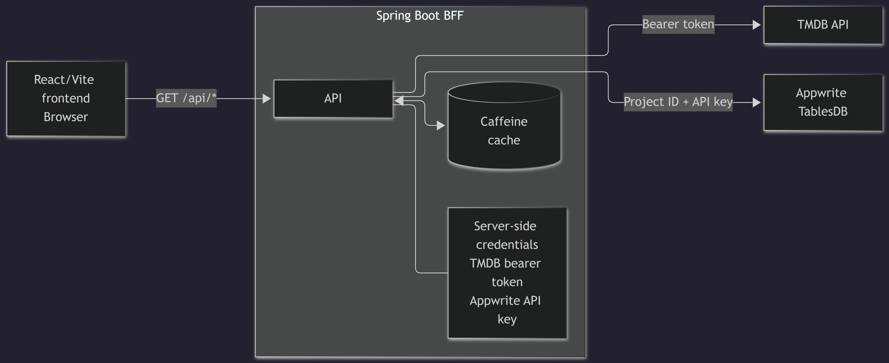
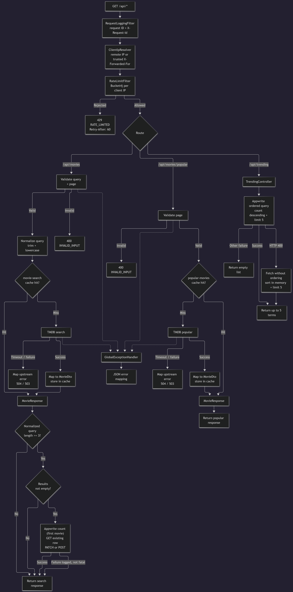

# Movie Radar BFF

A Spring Boot backend-for-frontend for [Movie Radar](https://movie-radar-beryl.vercel.app), a React/Vite movie search app ([frontend repo](https://github.com/tchiwara/movie-app)). Live API: https://movie-radar-bff.onrender.com (free tier, see [Deployment](#deployment)).

The BFF keeps the TMDB and Appwrite credentials on the server, validates and rate-limits browser requests, caches TMDB responses, maps them to compact DTOs, and records searched movies in Appwrite for trending analytics.

## Features

- TMDB search and popular-movies proxy with compact DTOs (no raw TMDB payloads)
- Trending via the Appwrite TablesDB REST API: one row per movie, with a per-client window so repeated searches for the same movie count once
- Input validation, per-IP rate limiting (Bucket4j), Caffeine caching
- Explicit CORS allowlist and trusted-proxy-aware client IP resolution
- Request IDs (`X-Request-Id`), request and upstream logging with credential redaction
- Uniform error contract and upstream timeout/availability mapping
- Fail-fast startup validation of required settings
- Multi-stage Docker image running as a non-root user

## Architecture

[](architecture/system-context.png)

*The browser only talks to the BFF. TMDB and Appwrite credentials stay on the server.*

[](architecture/request-lifecycle.png)

*Filters, validation, caching, upstream calls and error paths for each endpoint. Click the image to view it full size.*

## API

All endpoints are `GET`.

| Endpoint | Parameters | Notes |
|---|---|---|
| `/` | none | Small JSON welcome message. Does not call TMDB or Appwrite, so it is not a health check |
| `/api/movies` | `query` (required, non-blank, max 100 chars), `page` (default 1, range 1-500) | TMDB search; query is trimmed and lowercased |
| `/api/movies/popular` | `page` (default 1, range 1-500) | TMDB popular movies |
| `/api/trending` | none | Up to 5 most-searched movies from Appwrite |

```bash
curl "http://localhost:8080/api/movies?query=batman&page=1"
```

```json
{
  "movies": [
    {
      "id": 268,
      "title": "Batman",
      "posterUrl": "https://image.tmdb.org/t/p/w500/example.jpg",
      "voteAverage": 7.2,
      "originalLanguage": "en",
      "releaseYear": "1989"
    }
  ],
  "page": 1,
  "totalPages": 42
}
```

`/api/trending` returns `[{ "searchTerm", "count", "movieId", "posterUrl" }]`, where `searchTerm` is the movie title. `movieId` and `posterUrl` can be `null`.

### Errors

Every error uses `{ "status", "code", "message" }`. Upstream response bodies are never forwarded.

| Status | Code | Meaning |
|---:|---|---|
| 400 | `INVALID_INPUT` | Query or page failed validation |
| 404 | `NOT_FOUND` | Unknown route |
| 405 | `METHOD_NOT_ALLOWED` | Method not supported on that route |
| 429 | `RATE_LIMITED` | Rate limit exceeded (includes `Retry-After: 60`) |
| 503 | `UPSTREAM_UNAVAILABLE` | TMDB unavailable |
| 503 | `UPSTREAM_MISCONFIGURED` | Upstream rejected credentials (401/403) |
| 504 | `UPSTREAM_TIMEOUT` | Upstream request timed out |
| 500 | `INTERNAL_ERROR` | Unexpected error |

## Configuration

All configuration comes from environment variables. See `.env.example` for the names. Never commit real values.

| Variable | Default | Purpose |
|---|---|---|
| `TMDB_TOKEN` | required | TMDB bearer token |
| `APPWRITE_ENDPOINT` | required | Appwrite API endpoint |
| `APPWRITE_PROJECT_ID` | required | Appwrite project ID |
| `APPWRITE_DATABASE_ID` | required | Appwrite database ID |
| `APPWRITE_TABLE_ID` | required | Appwrite table ID |
| `APPWRITE_API_KEY` | required | Server-side Appwrite API key |
| `ALLOWED_ORIGINS` | empty | Comma-separated CORS origins, no spaces and no trailing slashes |
| `RATE_LIMIT_PER_MINUTE` | `60` | Requests per minute per client IP |
| `CACHE_TTL_MINUTES` | `10` | Cache expiry after write |
| `COUNT_DEDUPE_MINUTES` | `10` | Window in which one client's repeat searches for the same movie count once |
| `TRUSTED_PROXY_HOPS` | `0` | Trusted proxies in front of the app (see [Client IP](#caching-and-rate-limiting)) |
| `CONNECT_TIMEOUT_SECONDS` | `5` | Upstream connect timeout |
| `READ_TIMEOUT_SECONDS` | `10` | Upstream read timeout |
| `PORT` | `8080` | HTTP port (platforms such as Render set this themselves) |
| `LOG_LEVEL` | `INFO` | Log level for `dev.tchiwara.movieradar` |
| `FORWARD_HEADERS_STRATEGY` | `none` | Spring forward-headers strategy; leave as `none` |

Missing required settings fail startup immediately. Optional settings with defaults should be left unset rather than set to an empty value, because an empty value overrides the default.

## Run locally

Set the environment variables above, or copy `.env.example` to `.env` and fill it in (Spring imports `.env` from the working directory). Then:

```powershell
.\mvnw.cmd spring-boot:run      # Windows
./mvnw spring-boot:run          # Linux/macOS
```

```bash
curl "http://localhost:8080/"
curl "http://localhost:8080/api/movies/popular"
curl "http://localhost:8080/api/trending"
```

## Docker

Two-stage build: a Maven build stage, then a Temurin 17 JRE image running as a non-root `appuser`, started with `-XX:MaxRAMPercentage=75`.

```bash
docker build -t movie-radar-bff .
docker run --rm --name movie-radar-bff --env-file .env -p 8080:8080 movie-radar-bff
```

`.env` is read by Docker at run time and is not baked into the image.

## Deployment

Deployed as a Docker web service on Render (free instance: 0.1 CPU, 512 MB RAM) at https://movie-radar-bff.onrender.com, auto-deployed from `main`. All configuration is set as environment variables in the Render dashboard.

- **Port.** The app reads `PORT`, which Render sets (10000 in the observed deploy).
- **Proxy hops.** `TRUSTED_PROXY_HOPS=3` on Render. The correct value was found from real traffic: with 1 and 2, the logged client IP was an address belonging to the platform's proxy layers, and with 3 it matched the caller's real public IP. A forged `X-Forwarded-For` header does not change it, and a 150-request burst with a different forged header on every request was still limited to roughly 60-70 successes. Re-check this if the platform's proxy chain ever changes.
- **Health check.** None configured, because the app has no health endpoint yet.
- **Cold starts.** Free instances spin down after about 15 minutes without traffic, and startup took about 56 s in the observed deploy. Before the upstream timeouts were made configurable (they were fixed at 2 s connect and 5 s read), the first request after a sleep often failed with a `504`. After raising the defaults to 5 s and 10 s, a plain `curl` request sent after about 25 minutes idle returned `200` on the first try (one sample). The frontend also retries 502/503/504 responses while it shows a "waking up" message.

## Testing

```bash
./mvnw test
```

39 tests, all passing, using dummy configuration from `src/test/resources`, so no `.env` or real credentials are needed. They cover: application context startup, the root endpoint, controller input validation, global error mapping, TMDB response mapping and timeouts, log redaction, search normalization, non-fatal search-term counting, the per-client count window, rate limiting and `X-Forwarded-For` handling, and the Appwrite trending repository (row creation, count increments, race handling, error mapping, and the ordered-query fallback). External services are mocked, and there is no coverage report and no CI yet.

## Caching and rate limiting

**Cache.** Caffeine, in-memory per instance: `movie-search` (key `query:page`) and `popular-movies` (key `page`), 10 min expiry by default, max 500 entries.

**Search counting.** After the response is ready (cache hit or miss), the first returned movie is recorded in Appwrite as one row per movie: the row id is derived from the movie id, and the stored name is the movie title. A per-client window (10 minutes by default) skips repeat counts for the same movie from the same client, so typing a title one prefix at a time counts once. Counting is skipped when the normalized query is shorter than 3 characters or the result list is empty. Counting failures are logged and never fail the search.

**Rate limit.** Bucket4j token bucket per client IP on `/api/**`, 60 requests/minute by default with greedy refill. Rejected requests get `429` with `Retry-After: 60`. The root endpoint is not rate limited.

**Client IP.** With `TRUSTED_PROXY_HOPS=0` (default), `X-Forwarded-For` is ignored and the socket address is used, so the header can't be forged to dodge the limit. With N hops, the Nth entry from the right is used. Set it only to the number of proxies you actually control, and verify it against logged client IPs. Behind a platform proxy, a value of 0 puts every visitor in one shared bucket.

## Measured performance

Single requests, not a benchmark.

Local Docker run:

| Scenario | Time |
|---|---|
| Search, uncached | ~1.8 s |
| Search, cached | ~0.2-0.3 s |
| First request after container start | ~6.25 s (cold upstream connections) |

Render free tier, measured from India:

| Scenario | Time |
|---|---|
| Popular movies, warm | ~0.16-0.26 s |
| Search, uncached | ~1.7 s |
| Search, cached | ~0.48 s |
| Application startup | ~56 s |

The cached search is slower than a cached popular call because counting still runs on the request path.

## Security notes and limitations

**In place:** credentials are server-side only and redacted from logs; CORS is an explicit allowlist (no wildcard, `GET` only); input is bounded before any upstream call; non-root container; forwarded IPs are ignored unless explicitly trusted.

**Limitations:**
- The free instance sleeps when idle and takes roughly a minute to start. A request that arrives during a cold start can be slow or time out, which the frontend handles by retrying.
- Cache, rate-limit buckets and the count window are per instance, not shared across replicas.
- Concurrent cache misses each call TMDB, because there is no single-flight.
- Appwrite counting is read-then-write, so concurrent increments can lose updates.
- One row per movie relies on Appwrite accepting row ids derived from the movie id. It is covered by unit tests with mocked responses and has not been verified end to end against live data.
- Counting runs synchronously on the request path, adding latency to search, including cache hits.
- `/api/trending` returns an empty list on most Appwrite failures instead of an error.


## Roadmap

Health endpoint and metrics, counting off the request path, single-flight TMDB calls on cache misses, CI (tests + image build), integration tests for the full filter/controller flow.